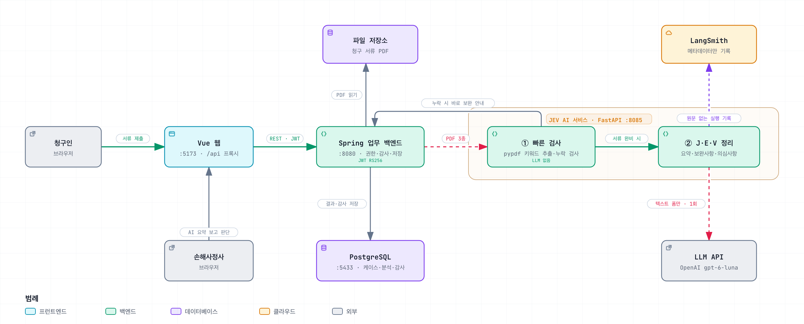

# InsuranceAI

AI 중립 청구 협업 플랫폼 — 청구인과 손해사정사가 같은 공간에서 소통하고,
그 사이를 AI가 중개(서류 구조화 · 요약/하이라이트/누락 탐지 · 약관 근거 평문 번역)한다.

## 아키텍처



> 확대·이동·테마 전환이 되는 인터랙티브 버전: [docs/architecture/architecture.html](docs/architecture/architecture.html) (내려받아 브라우저로 열기)

청구인 → AI 플랫폼 → 손해사정사 순서로 흐릅니다.

1. **빠른 검사 (LLM 없음)** — 청구인이 서류를 제출하면 AI 서비스가 PDF 텍스트에서 진단명·질병코드·날짜·병원명·금액 등을 추출해 누락을 검사합니다. 누락·판독 불가·서류 종류 오류는 LLM을 부르지 않고 청구인에게 바로 보완을 안내합니다.
2. **J·E·V 정리 (LLM 1회)** — 서류가 갖춰진 건만 추출한 키워드를 텍스트로 LLM에 보내 손해사정사용 요약·보완사항·의심사항을 받습니다. PDF 원본은 전송하지 않고, 환자명은 가명, 주민번호는 앞 6자리만 보냅니다.
3. **손해사정사 판단** — 결과를 보고 승인 · 보완 요청 · 반려를 선택하고, 청구인은 청구 건에서 수정 후 다시 제출합니다. AI는 최종 판정을 하지 않습니다.

| 구성 | 포트 | 역할 |
|---|---|---|
| Vue 웹 | 5173 | 청구인·손해사정사 화면, `/api` → 8080 프록시 |
| Spring 업무 백엔드 | 8080 | 권한·감사, 케이스·서류·분석 결과 저장 |
| JEV AI 서비스 (FastAPI) | 8085 | 빠른 검사, J·E·V 정리, LLM·LangSmith 호출 |
| PostgreSQL | 5433 | 업무 데이터 (Docker) |

## 구조

```
InsuranceAI/
├── back/
│   ├── insai/     Spring Boot 업무 백엔드
│   └── ai-service/ FastAPI · Gemini · JEV 분석 서비스
└── front/
    └── insai/     Vue 3 SPA (JavaScript)
```

> 향후 MSA로 분리 예정: gateway / auth / collab(청구 협업 코어) / form(양식·제출물) / document / ai(LLM 오케스트레이션)

## 기술 스택

- Backend: Java, Spring Boot, Gradle
- Frontend: Vue 3, Vite, JavaScript, Pinia, Vue Router
- Infra: Docker Compose (로컬)

## 브랜치 전략

- `main` — 배포 기준
- `dev` — 통합 개발
- `test` — QA / 테스트

## 개발

JEV 의료 청구 서류 분석의 설정과 실행은 [실행 안내](docs/ai/jev-cycle-acceptance.md),
요청·응답 및 개인정보 추적 정책은 [API 계약](docs/ai/jev-contract.md)을 참고하세요.
규정은 미등록 상태이며 최종 제출 판정은 보류합니다.
