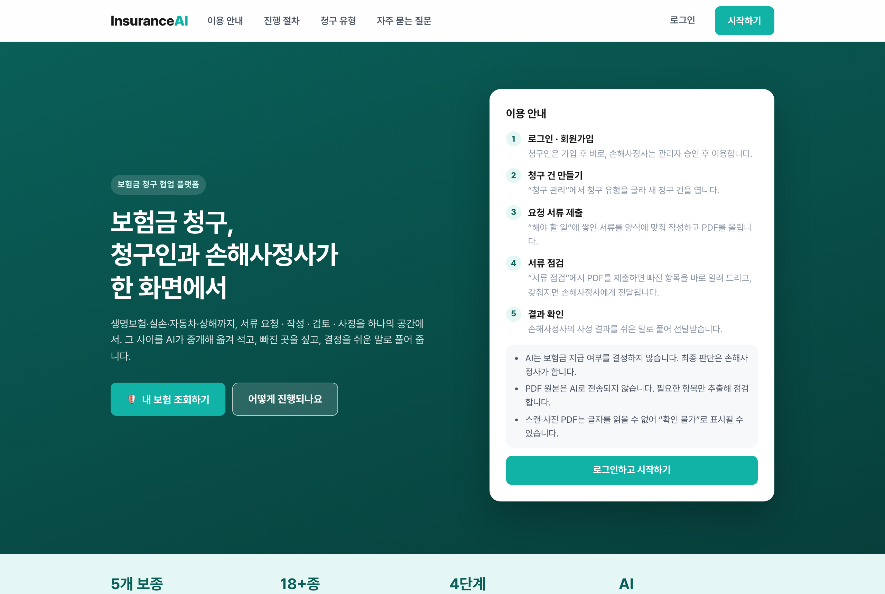
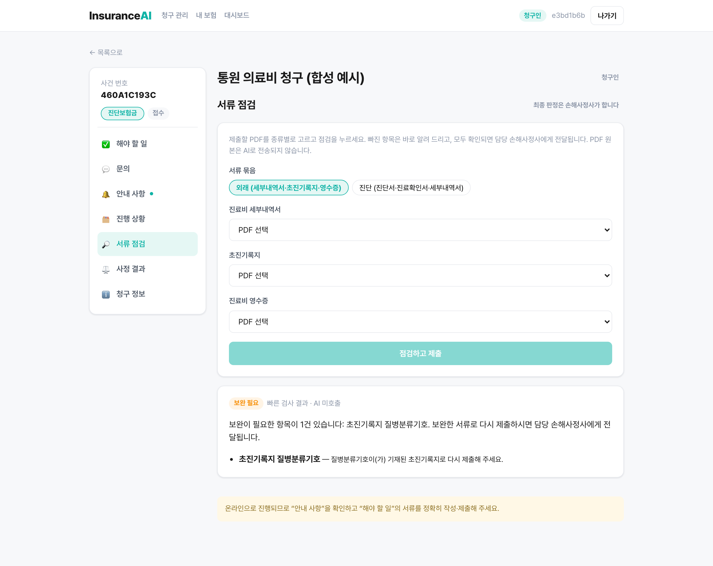
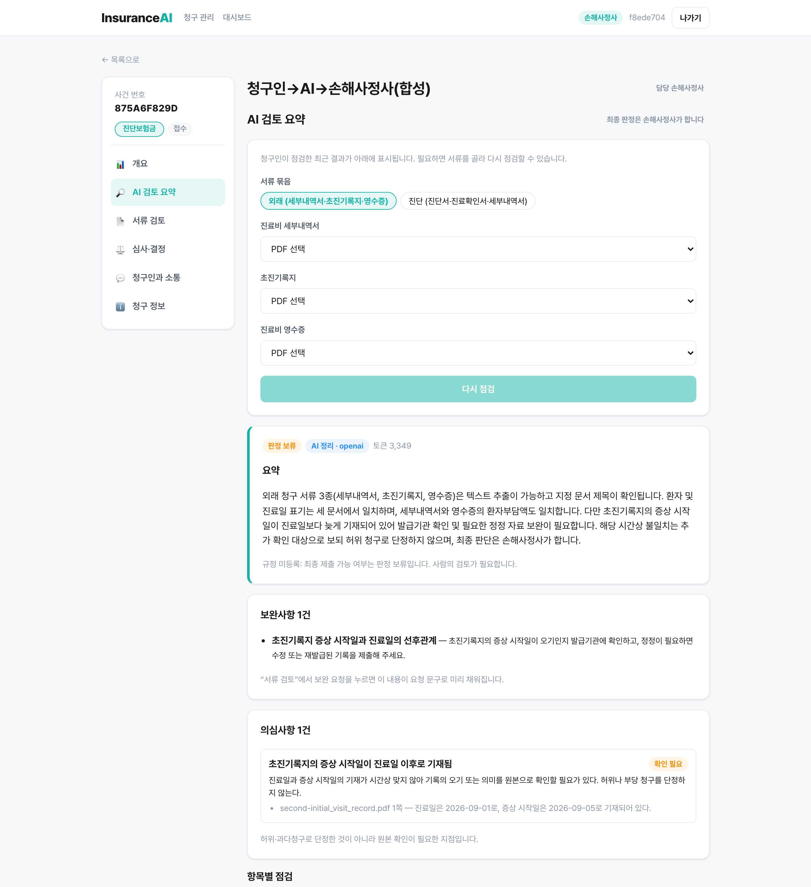
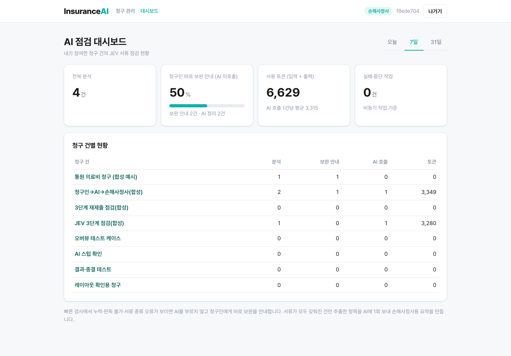
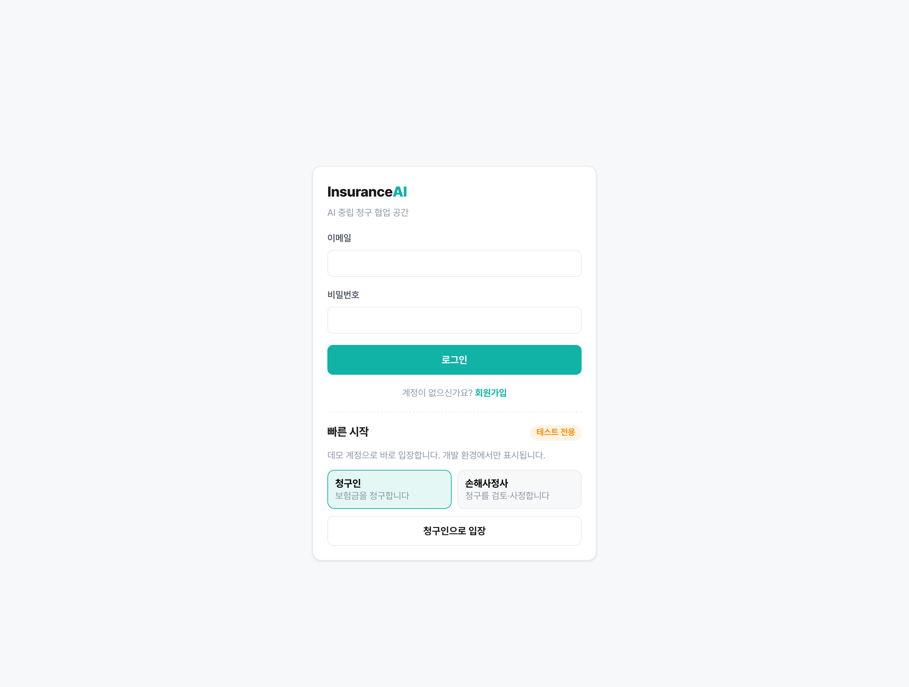
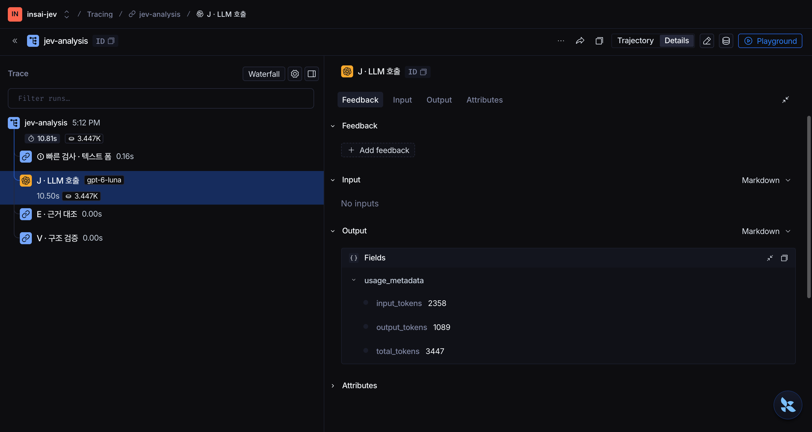

<div align="center">

# InsuranceAI

**청구인과 손해사정사 사이에서 AI가 의료 청구 서류를 먼저 검토하는 보험금 청구 협업 플랫폼**

빠진 서류는 청구인에게 바로 알려 주고, 갖춰진 서류만 AI가 요약해 손해사정사에게 넘깁니다.
최종 판단은 언제나 사람이 합니다.

[화면](#화면) · [아키텍처](#아키텍처) · [기술 적용 현황](#기술-적용-현황) · [시작하기](#시작하기) · [문서](#문서)



</div>

## 개요

보험금 청구에서 가장 많은 시간이 드는 일은 서류가 모자라 오가는 보완 요청입니다.
InsuranceAI는 청구인과 손해사정사가 한 공간에서 일하고, 그 사이에서 AI가 서류를 먼저 검토합니다.

- **빠른 1차 검사** — 진단명·질병코드·날짜·병원명·금액을 PDF에서 추출해 누락을 즉시 알려 줍니다. 이 단계는 LLM을 쓰지 않습니다.
- **손해사정사용 정리** — 서류가 갖춰진 건만 LLM이 요약·보완사항·의심사항으로 정리합니다. 근거 문서와 쪽수가 함께 붙습니다.
- **사람이 결정** — AI 결과는 항상 `판정 보류`이며, 손해사정사가 승인 · 보완 요청 · 반려를 결정합니다.

## 화면

<table>
  <tr>
    <td width="50%"></td>
    <td width="50%"></td>
  </tr>
  <tr>
    <td><b>청구인 · 서류 점검</b><br>질병분류기호가 빠진 초진기록지를 LLM 호출 없이 바로 보완 안내</td>
    <td><b>손해사정사 · AI 검토 요약</b><br>요약, 보완사항, 의심사항(근거 문서·쪽 포함)과 항목별 점검</td>
  </tr>
  <tr>
    <td></td>
    <td></td>
  </tr>
  <tr>
    <td><b>AI 점검 대시보드</b><br>LLM 없이 처리한 비율, 토큰 사용량, 청구 건별 현황</td>
    <td><b>로그인</b><br>개발 환경에서만 보이는 테스트용 빠른 시작</td>
  </tr>
  <tr>
    <td colspan="2"></td>
  </tr>
  <tr>
    <td colspan="2"><b>LangSmith 실행 기록</b><br>요청 하나가 <code>① 빠른 검사 → J · LLM 호출(gpt-6-luna, 10.5초, 3,447토큰) → E 근거 대조 → V 구조 검증</code>으로 기록됩니다. 입력은 비어 있고(No inputs) 출력에는 토큰 수만 남아 의료 원문이 LangSmith로 나가지 않습니다.</td>
  </tr>
</table>

> 화면의 서류와 인물은 모두 합성 데이터입니다.

## 아키텍처


<sub>Archify로 생성. 확대·이동이 되는 인터랙티브 버전은 [docs/architecture/architecture.html](docs/architecture/architecture.html)을 내려받아 브라우저로 여세요.</sub>

**청구인 → AI 플랫폼 → 손해사정사**

1. **① 빠른 검사 (LLM 없음)** — 청구인이 서류를 제출하면 pypdf로 텍스트 레이어에서 키워드를 추출하고, 문서 제목·필수 항목·문서 간 일치를 검사합니다. 누락·판독 불가·서류 종류 오류가 있으면 **LLM을 부르지 않고** 청구인에게 바로 보완을 안내합니다.
2. **② J·E·V 정리 (LLM 1회)** — 서류가 갖춰진 건만 추출한 키워드를 텍스트 폼으로 LLM에 보냅니다. Judgment(판정) → Evidence(인용한 문서·쪽이 실제로 있는지 코드로 대조) → Verification(근거 없는 판정 반려) 순서로 검증한 결과를 손해사정사에게 보여 줍니다.
3. **③ 손해사정사 판단** — 승인 · 보완 요청 · 반려를 선택합니다. 보완 요청 문구는 AI 제안으로 미리 채워지고, 청구인은 이전 작성 내용이 채워진 양식을 수정해 다시 제출합니다.

| 구성 | 포트 | 역할 |
|---|---|---|
| Vue 웹 | 5173 | 청구인·손해사정사 화면, `/api` → 8080 프록시 |
| Spring 업무 백엔드 | 8080 | JWT 인증, 케이스 참여자 권한, 감사 로그, 결과 저장 |
| JEV AI 서비스 (FastAPI) | 8085 | 빠른 검사, J·E·V 정리, LLM·LangSmith 호출 |
| PostgreSQL | 5433 | 케이스·서류·분석 결과·감사 (Docker) |

## 기술 적용 현황

요청 기술마다 **실제로 적용한 것**과 **적용하지 않은 것**을 구분해 적었습니다. 적용하지 않은 항목은 아키텍처의 어느 지점에 들어가는지 함께 밝혀 두었습니다.

| 영역 | 상태 | 이 프로젝트에서 |
|---|:---:|---|
| Multi-Agent & LangGraph | ⚪ 미적용 | 역할을 나눈 단계형 오케스트레이터와 조건부 경로 분기로 대체 |
| MCP | ⚪ 미적용 | Provider 포트, JSON Schema 구조화 출력, 버전 고정 프롬프트로 표준 인터페이스 구성 |
| RAG | ⚪ 미적용 | 규정·약관 미등록. 현재는 PDF 키워드 추출이 근거 |
| 아키텍처 및 코드 품질 | 🟢 적용 | 모듈러 모놀리스, 포트·어댑터, 의존성 주입, 테스트 1,000여 개 |
| 관측 가능성 및 평가 | 🟡 일부 | LangSmith 단계별 트레이싱(빠른 검사·LLM·E·V) 적용, 합성 구조 평가. LLM-as-a-Judge 미적용 |

<details open>
<summary><b>Multi-Agent & LangGraph</b> — 미적용, 단계형 오케스트레이터로 대체</summary>

LangGraph와 Supervisor 패턴은 쓰지 않습니다. 의료 서류를 다루므로 LLM 호출을 **요청당 최대 1회**로 묶고, 나머지 단계는 코드로 검증하도록 설계했습니다.

- **역할 분리** — `PREPARE → J → E → V` 단계를 각자의 체인이 맡습니다. LLM은 J만 호출하고, E·V는 LLM 답을 검문합니다. 단계 전이는 상태 기계로 강제합니다.
  [`orchestrator.py`](back/ai-service/app/chains/orchestrator.py) · [`judgment.py`](back/ai-service/app/chains/judgment.py) · [`evidence.py`](back/ai-service/app/chains/evidence.py) · [`verification.py`](back/ai-service/app/chains/verification.py)
- **조건부 경로 (동적 재계획에 해당)** — 빠른 검사 결과에 따라 "청구인에게 보완 안내"와 "LLM 정리"로 갈립니다. 모델 쪽에서는 우선순위 라우팅, 같은 공급자 내 폴백, 회로 차단기가 실행 경로를 바꿉니다.
  [`precheck.py`](back/ai-service/app/chains/precheck.py) · [`resilient_execution.py`](back/ai-service/app/application/resilient_execution.py) · [`routing_policy.py`](back/ai-service/app/providers/routing_policy.py)
- **도입한다면** — J 단계를 문서 종류별 서브에이전트(진단서·영수증·세부내역서)로 나누고, Supervisor가 의심 신호에 따라 추가 검토를 다시 계획하는 구조가 자연스럽습니다.

</details>

<details>
<summary><b>MCP</b> — 미적용, 표준 인터페이스는 내부 포트로 구성</summary>

MCP 서버는 없습니다. 같은 목적(교체 가능한 도구, 정해진 입출력, 관리되는 프롬프트)을 다음으로 구현했습니다.

- **Tool에 해당** — 모든 LLM 공급자는 `Provider.analyze()` 하나의 포트를 구현합니다. Gemini · OpenAI · Stub을 설정만으로 바꿉니다. 포트에는 PDF 필드가 없어서 어댑터가 원본을 보낼 수 없습니다.
  [`base.py`](back/ai-service/app/providers/base.py) · [`openai_provider.py`](back/ai-service/app/providers/openai_provider.py) · [`gemini_provider.py`](back/ai-service/app/providers/gemini_provider.py)
- **Prompt에 해당** — 프롬프트는 버전 파일로 관리하고 SHA-256으로 고정합니다. 응답마다 프롬프트·체인 버전이 기록됩니다.
  [`prompts/jev-v5.txt`](back/ai-service/app/chains/prompts/jev-v5.txt) · [`release.py`](back/ai-service/app/chains/release.py)
- **스키마 계약** — LLM 출력은 strict JSON Schema로 받고, Spring이 같은 계약을 다시 검증합니다. Python과 Java가 [공유 계약 예제](docs/ai/contracts/jev-response-example.json)로 함께 테스트됩니다.
- **도입한다면** — 키워드 추출기를 MCP Tool로, 약관을 Resource로, J·E·V 프롬프트를 Prompt로 노출하는 것이 다음 단계입니다.

</details>

<details>
<summary><b>RAG</b> — 미적용, 약관이 등록되면 J 단계에 주입</summary>

Vector DB와 의미 검색은 없습니다. 보험 약관·지급 기준이 아직 등록되지 않아서 모든 결과를 `판정 보류`로 둡니다.

- **현재의 근거** — LLM에 넣는 근거는 PDF 텍스트 레이어에서 라벨로 추출한 값(진단명, 질병코드, 날짜, 금액 등)과 그 쪽수입니다. 환자명은 가명, 주민번호는 앞 6자리만 보냅니다. [`precheck.py`](back/ai-service/app/chains/precheck.py)
- **도입한다면** — 약관·지급 기준을 Vector DB에 넣고, J 단계 텍스트 폼에 관련 조항을 함께 주입합니다. 근거 조항이 붙는 시점이 `판정 보류`를 풀 수 있는 조건입니다.

</details>

<details>
<summary><b>아키텍처 및 코드 품질</b> — 적용</summary>

- **모듈화** — Spring은 `auth · collab · form · document · ai · policy` 도메인 패키지마다 `api / application / domain / infrastructure` 층을 두고, 모듈 간 호출은 포트 인터페이스로만 합니다. FastAPI는 `api / application / chains / providers / core / schemas`로 나눴습니다. [아키텍처 규칙](harness/01-architecture.md)
- **의존성 주입** — Spring 생성자 주입, FastAPI `Depends`. 시계·대기·HTTP 전송·추적기를 주입받아 재시도·회로 차단·비용 로직을 네트워크 없이 테스트합니다. [`resilient_execution.py`](back/ai-service/app/application/resilient_execution.py)
- **단위·통합 테스트** — AI 서비스 pytest 630개, Spring JUnit 393개. ruff·mypy 정적 검사와 GitHub Actions(`ai-service.yml`)를 씁니다.
- **경계 방어** — 중복 JSON 키·과도한 중첩 거부, JavaScript·첨부파일이 있는 PDF 차단, 문서 텍스트는 비신뢰 데이터로 취급(프롬프트 인젝션 방지). [`json_guard.py`](back/ai-service/app/core/json_guard.py) · [`pdf_safety.py`](back/ai-service/app/core/pdf_safety.py)
- **DB 마이그레이션** — Flyway `V1`–`V11`.

</details>

<details>
<summary><b>관측 가능성 및 평가</b> — LangSmith 적용, LLM-as-a-Judge 미적용</summary>

- **LangSmith 트레이싱** — 요청마다 `jev-analysis` 아래에 단계별 하위 실행을 남깁니다. LLM을 부른 건은 `① 빠른 검사 → J · LLM 호출 → E · 근거 대조 → V · 구조 검증`, 청구인에게 바로 보완을 안내한 건은 `① 빠른 검사 · LLM 미호출` 하나입니다. J 단계는 `llm` 실행으로 기록돼 모델명과 토큰이 LangSmith 표준 화면에 나타납니다. 입력은 모두 비우고, 출력은 정수 토큰 수만 통과시키며, 메타데이터는 허용 목록(공급자·모델·프롬프트 버전·시도 횟수·단계 상태)만 보냅니다. 실계정에서 원문이 남지 않는 것을 확인했습니다. [`langsmith.py`](back/ai-service/app/observability/langsmith.py) · [`metadata.py`](back/ai-service/app/observability/metadata.py)

  
- **대시보드** — 앱의 `/dashboard`에서 LLM 없이 처리한 비율, 토큰 사용량, 청구 건별 현황을 봅니다. 감사 로그는 분석·조회의 허용과 거부를 모두 남깁니다.
- **평가** — `make evaluate`가 합성 데이터로 J/E/V 구조 회귀를 검사합니다(정상 3건, 다른 문서 인용·없는 쪽 인용 거부 2건). 임상 정확도나 누락 탐지율을 재는 평가는 아닙니다.
- **도입한다면** — 라벨링한 검토 데이터가 생기면 LLM-as-a-Judge로 요약의 근거 일치도와 의심사항의 타당성을 채점하고, 사람 라벨과의 일치율을 함께 보고합니다.

</details>

<details>
<summary><b>기타 적용 기술</b></summary>

- **비용 최소화** — PDF 대신 추출한 키워드만 전송(테스트 묶음 기준 약 1,500자), 누락 건은 LLM 미호출, 재시도 1회 제한, 요청·일일 비용 상한과 분당 요청 제한.
- **역할별 응답** — 의심사항과 손해사정사용 요약은 서버가 청구인 응답에서 제외합니다.
- **인증** — 사용자는 JWT(RS256), Spring ↔ FastAPI는 별도 서비스 토큰.
- **비동기 분석** — 멱등 키가 있는 DB 작업 큐(작업자는 기본 비활성).
- **다이어그램** — [Archify](https://github.com/tt-a1i/archify)로 아키텍처를 생성하고 교차선·가독성을 자동 검사.

</details>

## 시작하기

**필요 환경**: Docker, JDK 21, Python 3.11 이상, Node.js 20 이상

```bash
# 1. PostgreSQL · Redis
docker compose up -d

# 2. AI 서비스 (:8085) — .env의 JEV_SERVICE_TOKEN, 공급자, 키를 채웁니다
cd back/ai-service
python3 -m venv .venv && cp .env.example .env
make install && make run

# 3. 업무 백엔드 (:8080) — AI 서비스와 같은 서비스 토큰을 씁니다
cd back/insai
JEV_SERVICE_TOKEN=<.env와 같은 값> ./gradlew bootRun

# 4. 웹 (:5173)
cd front/insai
npm install && npm run dev
```

http://localhost:5173 에 접속해 로그인 화면 아래의 **빠른 시작**으로 청구인 또는 손해사정사 데모 계정에 들어갑니다.
키 없이 둘러보려면 `.env`에서 `JEV_PROVIDER=stub`으로 두고, 백엔드를 `JEV_ALLOW_STUB=true`로 실행하세요.
설정 항목은 [설정과 비밀값](docs/ai/configuration-secrets.md)을 참고하세요.

## 테스트

```bash
cd back/ai-service && make check      # ruff · mypy · pytest
cd back/ai-service && make evaluate   # 합성 J/E/V 구조 평가
cd back/insai && ./gradlew test       # Spring 단위·통합 테스트
cd front/insai && npm run build       # 프론트 빌드 확인
```

## 프로젝트 구조

```
InsuranceAI/
├── back/
│   ├── insai/          Spring Boot 업무 백엔드 (auth · collab · form · document · ai · policy)
│   └── ai-service/     FastAPI JEV 서비스
│       └── app/
│           ├── chains/        빠른 검사 · J/E/V 체인 · 오케스트레이터 · 프롬프트
│           ├── providers/     Gemini · OpenAI · Stub 어댑터, 라우팅 · 회로 차단기
│           ├── application/   실행·재시도·비용 관리
│           ├── core/          설정 · 보안 · 입력 방어 · 사용량 제한
│           └── observability/ LangSmith · 평가
├── front/insai/        Vue 3 SPA
├── docs/               아키텍처 · 스크린샷 · AI 설계 문서
└── harness/            도메인 · 아키텍처 · 작업 규칙
```

## 문서

| 문서 | 내용 |
|---|---|
| [규칙 사전 점검](docs/ai/rule-precheck.md) | 추출 항목, 개인정보 처리, 한계 |
| [JEV 계약](docs/ai/jev-contract.md) | 요청·응답 형식과 추적 정책 |
| [AI 권한 정책](docs/ai/ai-authority-policy.md) | AI가 결정하지 않는 범위 |
| [서비스 경계](docs/ai/service-boundaries.md) | Spring과 FastAPI의 책임 분리 |
| [관측성](docs/ai/observability-dashboard.md) | LangSmith 경계, 통계 API |
| [실행 안내](docs/ai/jev-cycle-acceptance.md) | 실제 모델 연결 절차 |

## 현재 한계

- **OCR 없음** — 스캔·사진 PDF는 글자를 읽지 못해 보완 안내로 처리합니다.
- **추출 방식** — 라벨과 값이 같은 줄에 있어야 추출됩니다. 표 형식 서식은 값이 있어도 누락으로 판단될 수 있습니다.
- **규정 미등록** — 약관 근거가 없어 모든 결과가 `판정 보류`입니다.
- **업무 API 인증** — JWT 검증은 JEV 경로에만 적용되어 있고, 다른 업무 API는 `X-User-Id` 헤더를 신뢰합니다(게이트웨이 도입 예정).

## 브랜치 전략

`main` 배포 기준 · `dev` 통합 개발 · `test` QA
