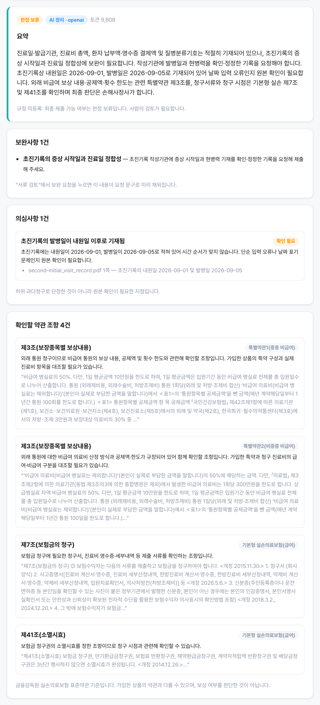
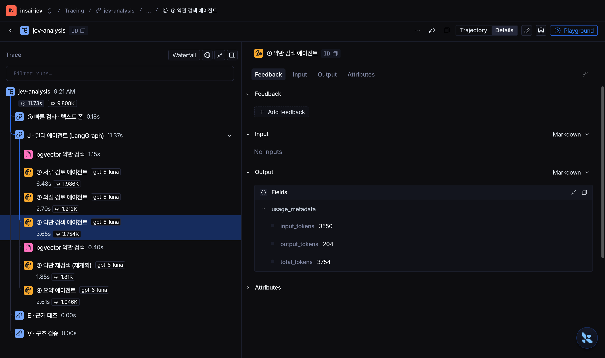

<div align="center">

# InsuranceAI

**청구인과 손해사정사 사이에서 AI가 의료 청구 서류를 먼저 검토하는 보험금 청구 협업 플랫폼**

빠진 서류는 청구인에게 바로 알려 주고, 갖춰진 서류만 AI 에이전트 팀이 정리해 손해사정사에게 넘깁니다.
최종 판단은 언제나 사람이 합니다.

[화면](#화면) · [아키텍처](#아키텍처) · [기술 적용 현황](#기술-적용-현황) · [시작하기](#시작하기) · [문서](#문서)


</div>

## 개요

보험금 청구에서 가장 많은 시간이 드는 일은 서류가 모자라 오가는 보완 요청입니다.
InsuranceAI는 청구인과 손해사정사가 한 공간에서 일하고, 그 사이에서 AI가 서류를 먼저 검토합니다.

- **빠른 1차 검사** — 진단명·질병코드·날짜·병원명·금액을 PDF에서 추출해 누락을 즉시 알려 줍니다. 이 단계는 LLM을 쓰지 않습니다.
- **멀티 에이전트 정리** — 서류가 갖춰진 건만 LangGraph Supervisor가 서류 검토·의심 검토·약관 검색 에이전트를 병렬로 돌리고, 요약 에이전트가 손해사정사용으로 정리합니다.
- **약관 근거 (RAG)** — 금융감독원 표준약관과 보험사 2곳(삼성화재·한화생명)의 실손 약관을 pgvector에 넣고, 약관 에이전트가 이 청구에서 확인할 조항을 찾아 이유와 함께 설명합니다.
- **사람이 결정** — AI 결과는 항상 `판정 보류`이며, 손해사정사가 승인 · 보완 요청 · 반려를 결정합니다.

## 화면

<table>
  <tr>
    <td width="50%"></td>
    <td width="50%"></td>
  </tr>
  <tr>
    <td><b>청구인 · 서류 점검</b><br>질병분류기호가 빠진 초진기록지를 LLM 호출 없이 바로 보완 안내</td>
    <td><b>손해사정사 · AI 검토 요약</b><br>요약 · 보완사항 · 의심사항, 그리고 RAG로 찾은 <b>확인할 약관 조항</b></td>
  </tr>
  <tr>
    <td colspan="2"></td>
  </tr>
  <tr>
    <td colspan="2"><b>LangSmith 멀티 에이전트 실행 기록</b><br><code>J · 멀티 에이전트 (LangGraph)</code> 아래에 pgvector 검색과 서류 검토·의심 검토·약관 검색(병렬) → 의심 신호에 따른 약관 재검색(재계획) → 요약 에이전트가 각각의 모델·시간·토큰과 함께 기록됩니다. 입력은 비어 있고 출력은 토큰 수만 남습니다.</td>
  </tr>
  <tr>
    <td></td>
    <td></td>
  </tr>
  <tr>
    <td><b>AI 점검 대시보드</b><br>LLM 없이 처리한 비율, 토큰 사용량, 청구 건별 현황</td>
    <td><b>로그인</b><br>개발 환경에서만 보이는 테스트용 빠른 시작</td>
  </tr>
</table>

> 화면의 서류와 인물은 모두 합성 데이터입니다. 약관 조항은 실제 공개 약관입니다.

## 아키텍처


<sub>Archify로 생성. 확대·이동이 되는 인터랙티브 버전은 [docs/architecture/architecture.html](docs/architecture/architecture.html)을 내려받아 브라우저로 여세요.</sub>

**청구인 → AI 플랫폼 → 손해사정사**

1. **① 빠른 검사 (LLM 없음)** — 청구인이 서류를 제출하면 pypdf로 텍스트 레이어에서 키워드를 추출하고, 문서 제목·필수 항목·문서 간 일치를 검사합니다. 누락·판독 불가·서류 종류 오류가 있으면 **LLM을 부르지 않고** 청구인에게 바로 보완을 안내합니다.
2. **② LangGraph 멀티 에이전트 (서류 완비 건만)** — Supervisor가 세 전문 에이전트를 병렬로 실행합니다. 의심 검토 에이전트가 MEDIUM 이상 신호를 내면 약관 에이전트에 면책 조항 재검색을 맡기고(동적 재계획), 마지막에 요약 에이전트가 정리합니다. 이어서 E(인용한 문서·쪽 대조)와 V(근거 없는 판정 반려)가 결과를 검문합니다.
3. **③ 손해사정사 판단** — 승인 · 보완 요청 · 반려를 선택합니다. 보완 요청 문구는 AI 제안으로 미리 채워지고, 청구인은 이전 작성 내용이 채워진 양식을 수정해 다시 제출합니다.

| 구성 | 포트 | 역할 |
|---|---|---|
| Vue 웹 | 5173 | 청구인·손해사정사 화면, `/api` → 8080 프록시 |
| Spring 업무 백엔드 | 8080 | JWT 인증, 케이스 참여자 권한, 감사 로그, 결과 저장 |
| JEV AI 서비스 (FastAPI) | 8085 | 빠른 검사, 멀티 에이전트, LLM·LangSmith 호출 |
| PostgreSQL + pgvector | 5433 | 업무 데이터, 약관 벡터 (Docker) |
| MCP 서버 ×2 | stdio | `insai-documents` · `insai-policy` |

## 기술 적용 현황

| 영역 | 상태 | 이 프로젝트에서 |
|---|:---:|---|
| Multi-Agent & LangGraph | 🟢 적용 | Supervisor + 서류 검토·의심 검토·약관 검색·요약 에이전트, 병렬 실행, 의심 신호에 따른 재계획 |
| LangChain | 🟢 적용 | 에이전트별 `ChatOpenAI.with_structured_output`(strict JSON Schema), `OpenAIEmbeddings` |
| MCP | 🟢 적용 | MCP 서버 2개: 서류 추출(Tool·Resource·Prompt), 약관 검색(Tool·Resource·Prompt) |
| RAG | 🟢 적용 | 금감원 표준약관 + 삼성화재·한화생명 실손 약관 416개 조항 → pgvector, 다중 질의 검색, 검색된 조항만 인용 허용 |
| 아키텍처 및 코드 품질 | 🟢 적용 | 모듈러 모놀리스, 포트·어댑터, 의존성 주입, 테스트 1,029개 |
| 관측 가능성 및 평가 | 🟡 일부 | LangSmith 에이전트별 트레이싱, 합성 구조 평가. LLM-as-a-Judge 미적용 |

<details open>
<summary><b>Multi-Agent & LangGraph</b> — Supervisor와 4개 전문 에이전트</summary>

멀티 에이전트는 **서류가 갖춰진 건에만** 동작합니다. 누락 건은 빠른 검사에서 끝나므로 LLM 비용이 들지 않습니다.

| 에이전트 | 하는 일 | 출력 |
|---|---|---|
| **Supervisor** | 다음 에이전트를 고르고, 의심 신호가 있으면 재계획 (LangGraph 라우팅 노드, LLM 호출 없음) | 실행 계획 |
| ① 서류 검토 | 문서별 작성 상태 판정과 보완사항 | `items` |
| ② 약관 검색 | pgvector에서 조항을 찾아 확인할 조항 1~4개 선택 | `policy_refs` |
| ③ 의심 검토 | 서버가 계산한 이상 징후와 추출 값으로 허위·과다청구 의심 신호 | `risk_signals` |
| ④ 요약 | ①~③ 결과를 손해사정사용 3~5문장으로 | `summary` |

- **병렬 실행** — ①②③은 서로 의존하지 않아 같은 단계에서 동시에 실행됩니다. 실제 실행 기준 약 12초, 약 9,800토큰.
- **동적 재계획** — ③이 MEDIUM·HIGH 신호를 내면 Supervisor가 ②에 "보상하지 않는 사항" 재검색을 한 번 더 맡깁니다.
- **기존 안전장치 재사용** — 팀 전체가 기존 `Provider` 포트 뒤에 있어서 재시도·회로 차단·비용 상한·E/V 검증이 그대로 적용됩니다.

[`agents/team.py`](back/ai-service/app/agents/team.py) · [`agents/provider.py`](back/ai-service/app/agents/provider.py) · [`prompts/jev-v7.txt`](back/ai-service/app/jev/prompts/jev-v7.txt)

</details>

<details>
<summary><b>LangChain</b> — 에이전트의 모델 호출과 임베딩</summary>

- **구조화 출력** — 에이전트마다 `ChatOpenAI.with_structured_output(schema, method="json_schema", strict=True)`로 정해진 스키마만 받고, 서버가 모든 검증기를 다시 실행합니다. Gemini로 바꾸면 `ChatGoogleGenerativeAI`를 같은 방식으로 씁니다.
- **임베딩** — `OpenAIEmbeddings`(text-embedding-3-small)로 약관 조항과 검색 질의를 임베딩합니다.
- **프롬프트 관리** — 단일 호출용과 에이전트 4종 프롬프트를 한 번들(`jev-v7`)로 묶어 SHA-256으로 고정합니다.

</details>

<details>
<summary><b>RAG</b> — 금융감독원 표준약관 + 보험사 2곳 실손 약관</summary>

- **원천** — 작게, 공식 자료만 골랐습니다. 모두 조 단위로 나눠 **416개 조항**입니다.
  | 원천 | 상품 | 조항 수 |
  |---|---|---|
  | 금융감독원 「보험업감독업무시행세칙 [별표15] 표준약관」(2026-09-11 등록본) | 기본형 · 특약1 · 특약2 | 123 |
  | 삼성화재 다이렉트 「무배당 삼성화재 다이렉트 실손의료비보험」 약관 | 기본형 · 특약1 · 특약2 | 140 |
  | 한화생명 「기본형 급여 e실손의료비보장보험(갱신형) 무배당」 약관(2026-01-05) | 주계약 · 급여 특약 · 비급여 특약 | 153 |

  [`rag/data/`](back/ai-service/app/rag/data)
- **벡터 DB** — 기존 Postgres를 `pgvector/pgvector:pg16` 이미지로 바꿔 같은 DB에 저장합니다. `python -m scripts.ingest_terms`로 적재합니다.
- **다중 질의 검색** — ① 진료 유형별 보상내용 ② 보험금 청구 서류 ③ 이 청구의 진단·진료 정보, 세 질의의 결과를 합칩니다. 검색어에는 환자 식별 정보가 들어가지 않습니다.
- **환각 방지** — 에이전트는 검색된 조항 ID 중에서만 고르고 이유만 씁니다. 조항 제목·원문은 서버가 약관에서 채우며, 검색되지 않은 조항을 인용하면 결과 전체를 거부합니다.

[`rag/chunking.py`](back/ai-service/app/rag/chunking.py) · [`rag/store.py`](back/ai-service/app/rag/store.py)

</details>

<details>
<summary><b>MCP</b> — 서버 2개, Tool · Resource · Prompt</summary>

| 서버 | Tool | Resource | Prompt |
|---|---|---|---|
| `insai-documents` | `extract_fields` (가명 처리된 텍스트 폼), `check_missing` (누락 검사) | `insai://required-fields` | `jev_review` |
| `insai-policy` | `search_clauses` (pgvector 검색) | `insai://terms/{clause_id}` (조항 원문) | `policy_review` |

```bash
cd back/ai-service
.venv/bin/python -m app.mcp_servers.documents   # stdio
.venv/bin/python -m app.mcp_servers.policy      # stdio, JEV_RAG_DATABASE_URL 필요
```

서비스 내부 분석 흐름은 같은 로직을 직접 호출하고(지연 최소화), MCP 서버는 외부 에이전트·클라이언트용 표준 인터페이스입니다. 실제 stdio MCP 클라이언트로 호출하는 테스트가 있습니다. [`mcp_servers/`](back/ai-service/app/mcp_servers)

</details>

<details>
<summary><b>아키텍처 및 코드 품질</b> — 적용</summary>

- **모듈화** — Spring은 `auth · collab · form · document · ai · policy` 도메인 패키지마다 `api / application / domain / infrastructure` 층을 두고, 모듈 간 호출은 포트 인터페이스로만 합니다. AI 서비스는 `api / application / jev / agents / rag / providers / mcp_servers / core / schemas`로 나눴고, JEV 파이프라인은 `jev/` 한곳에 모았습니다. [아키텍처 규칙](harness/01-architecture.md)
- **의존성 주입** — Spring 생성자 주입, FastAPI `Depends`. 에이전트 팀은 채팅 모델과 검색기를 주입받아, 가짜 모델과 메모리 벡터 저장소로 네트워크 없이 테스트합니다.
- **단위·통합 테스트** — AI 서비스 pytest 643개, Spring JUnit 386개. ruff·mypy 정적 검사와 GitHub Actions(`ai-service.yml`)를 씁니다.
- **경계 방어** — 중복 JSON 키·과도한 중첩 거부, JavaScript·첨부파일이 있는 PDF 차단, 문서 텍스트와 약관 텍스트는 비신뢰 데이터로 취급(프롬프트 인젝션 방지). [`json_guard.py`](back/ai-service/app/core/json_guard.py) · [`pdf_safety.py`](back/ai-service/app/core/pdf_safety.py)

</details>

<details>
<summary><b>관측 가능성 및 평가</b> — LangSmith 적용, LLM-as-a-Judge 미적용</summary>

- **LangSmith 트레이싱** — `jev-analysis` 아래에 `① 빠른 검사 → J · 멀티 에이전트 (LangGraph) → E → V`가 남고, J 아래에 에이전트와 pgvector 검색이 각각 `llm`·`retriever` 실행으로 기록됩니다. 입력은 모두 비우고, 출력은 정수 토큰 수만 통과시키며, 메타데이터는 허용 목록만 보냅니다. 실계정에서 원문·진단명·조항 텍스트가 남지 않는 것을 확인했습니다. [`langsmith.py`](back/ai-service/app/observability/langsmith.py)
- **대시보드** — 앱의 `/dashboard`에서 LLM 없이 처리한 비율, 토큰 사용량, 청구 건별 현황을 봅니다.
- **평가** — `make evaluate`가 합성 데이터로 J/E/V 구조 회귀를 검사합니다. 임상 정확도나 누락 탐지율을 재는 평가는 아닙니다.
- **도입한다면** — 라벨링한 검토 데이터가 생기면 LLM-as-a-Judge로 요약의 근거 일치도와 약관 조항 선택의 타당성을 채점하고, 사람 라벨과의 일치율을 함께 보고합니다.

</details>

<details>
<summary><b>기타 적용 기술</b></summary>

- **비용 최소화** — PDF 대신 추출한 키워드만 전송, 누락 건은 LLM 미호출, 에이전트는 필요한 입력만 받음, 재시도 1회 제한과 비용 상한.
- **역할별 응답** — 의심사항·손해사정사용 요약·약관 조항은 서버가 청구인 응답에서 제외합니다.
- **인증** — 사용자는 JWT(RS256), Spring ↔ FastAPI는 별도 서비스 토큰.
- **다이어그램** — [Archify](https://github.com/tt-a1i/archify)로 아키텍처를 생성하고 교차선·가독성을 자동 검사.

</details>

## 시작하기

**필요 환경**: Docker, JDK 21, Python 3.11 이상, Node.js 20 이상

```bash
# 1. PostgreSQL(pgvector) · Redis
docker compose up -d

# 2. AI 서비스 (:8085) — .env에 JEV_SERVICE_TOKEN, 공급자·키, JEV_MULTI_AGENT, JEV_RAG_DATABASE_URL
cd back/ai-service
python3 -m venv .venv && cp .env.example .env
make install
.venv/bin/python -m scripts.ingest_terms   # 약관 416개 조항을 pgvector에 적재 (최초 1회)
make run

# 3. 업무 백엔드 (:8080) — AI 서비스와 같은 서비스 토큰을 씁니다
cd back/insai
JEV_SERVICE_TOKEN=<.env와 같은 값> ./gradlew bootRun

# 4. 웹 (:5173)
cd front/insai
npm install && npm run dev
```

http://localhost:5173 에 접속해 로그인 화면 아래의 **빠른 시작**으로 청구인 또는 손해사정사 데모 계정에 들어갑니다.
키 없이 둘러보려면 `.env`에서 `JEV_PROVIDER=stub`, `JEV_MULTI_AGENT=false`로 두고 백엔드를 `JEV_ALLOW_STUB=true`로 실행하세요.
설정 항목은 [설정과 비밀값](docs/ai/configuration-secrets.md)을 참고하세요.

## 테스트

```bash
cd back/ai-service && make check      # ruff · mypy · pytest (에이전트·RAG·MCP 포함)
cd back/ai-service && make evaluate   # 합성 J/E/V 구조 평가
cd back/insai && ./gradlew test       # Spring 단위·통합 테스트
cd front/insai && npm run build       # 프론트 빌드 확인
```

## 프로젝트 구조

```
InsuranceAI/
├── back/
│   ├── insai/          Spring Boot 업무 백엔드 (auth · collab · form · document · ai · policy)
│   └── ai-service/     FastAPI JEV 서비스
│       └── app/
│           ├── jev/           JEV 파이프라인: 빠른 검사 · J/E/V · 오케스트레이터 · 프롬프트
│           ├── agents/        LangGraph Supervisor와 전문 에이전트
│           ├── rag/           약관 조항 분할 · pgvector 검색
│           ├── mcp_servers/   MCP 서버 (insai-documents, insai-policy)
│           ├── providers/     Gemini · OpenAI · Stub 어댑터, 라우팅 · 회로 차단기
│           ├── application/   실행·재시도·비용 관리
│           ├── core/          설정 · 보안 · 입력 방어 · 사용량 제한
│           └── observability/ LangSmith · 평가
├── front/insai/        Vue 3 SPA
├── docs/               아키텍처 · 스크린샷 · AI 설계 문서
├── samples/            합성 의료 서류 PDF (데모용)
└── harness/            도메인 · 아키텍처 · 작업 규칙
```

## 문서

| 문서 | 내용 |
|---|---|
| [멀티 에이전트·RAG·MCP](docs/ai/multi-agent-rag-mcp.md) | 에이전트 구성, 약관 RAG, MCP 서버 설계 |
| [규칙 사전 점검](docs/ai/rule-precheck.md) | 추출 항목, 개인정보 처리, 한계 |
| [JEV 계약](docs/ai/jev-contract.md) | 요청·응답 형식과 추적 정책 |
| [AI 권한 정책](docs/ai/ai-authority-policy.md) | AI가 결정하지 않는 범위 |
| [서비스 경계](docs/ai/service-boundaries.md) | Spring과 FastAPI의 책임 분리 |
| [관측성](docs/ai/observability-dashboard.md) | LangSmith 경계, 통계 API |

## 현재 한계

- **OCR 없음** — 스캔·사진 PDF는 글자를 읽지 못해 보완 안내로 처리합니다.
- **추출 방식** — 라벨과 값이 같은 줄에 있어야 추출됩니다. 표 형식 서식은 값이 있어도 누락으로 판단될 수 있습니다.
- **약관은 설명용** — 에이전트는 검색한 조항을 "확인할 조항"으로 설명할 뿐, 청구인의 가입 상품을 특정하거나 보상 여부를 판단하지 않습니다. 결과는 항상 `판정 보류`입니다.
- **LLM 호출 증가** — 멀티 에이전트는 서류 완비 건에서 에이전트 수만큼(4~5회) 호출합니다.
- **업무 API 인증** — JWT 검증은 JEV 경로에만 적용되어 있고, 다른 업무 API는 `X-User-Id` 헤더를 신뢰합니다(게이트웨이 도입 예정).

## 브랜치 전략

`main` 배포 기준 · `dev` 통합 개발 · `test` QA
